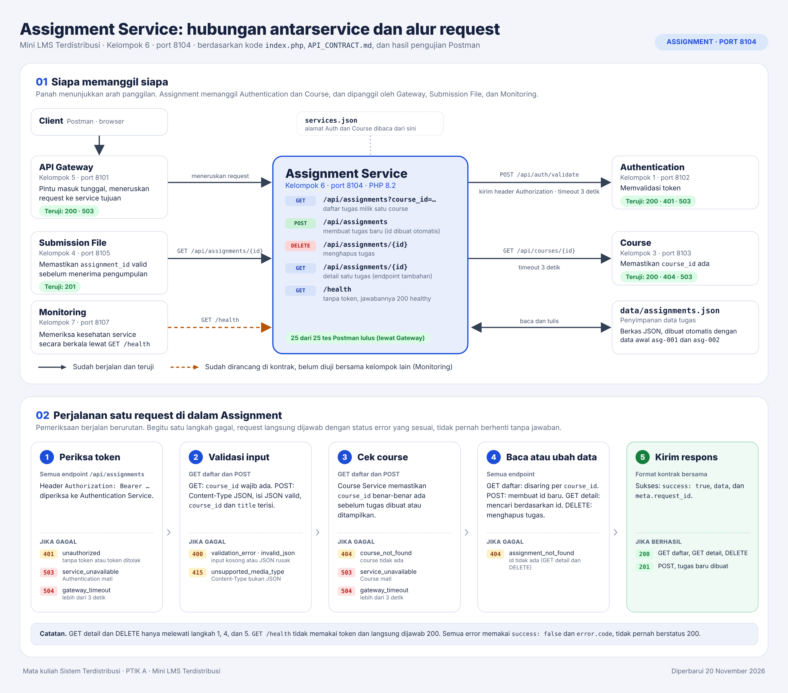

# Assignment Service: Mini LMS Terdistribusi (Kelompok 6)

Service untuk mengelola tugas (assignment) pada proyek Mini LMS Terdistribusi, mata kuliah Sistem Terdistribusi. Setiap tugas terkait dengan satu `course_id`.

## Identitas anggota dan pembagian kontribusi

| Nama | NIM | Kontribusi |
| --- | --- | --- |
| UCI ADITYANTIKASARI | 240209502001 | Implementasi service (tiga endpoint, /health, pemeriksaan token), kontrak API, koleksi Postman, repositori GitHub. Peran demo: fungsi utama (daftar, detail, buat, hapus) dan uji kegagalan 503 |
| NURHANDAYANI | 240209502024 | Penanggung jawab koordinasi antarkelompok. Peran demo: health check |
| MUHAMMAD FAUZAN | 240209502034 | Penanggung jawab dokumentasi pengujian (TESTING.md dan bukti). Peran demo: penanganan error (400 dan 404) |
| ANDI NURRIZQAH HAMDANA | 240209501084 | Penanggung jawab diagram alur. Peran demo: autentikasi (akun demo dan cara login) |

## Informasi service

| Item | Nilai |
| --- | --- |
| Nama service | Assignment Service |
| Port | 8104 |
| Alamat | http://127.0.0.1:8104 |
| Bahasa dan runtime | PHP 8.2 (dari XAMPP) |
| Penyimpanan data | Berkas JSON di `data/assignments.json` (dibuat otomatis) |
| Data awal | Dua tugas untuk dua course: `asg-001` (`course-001`) dan `asg-002` (`course-002`) |

Jika `data/assignments.json` dihapus, berkas itu dibuat ulang dengan data awal saat service menerima request berikutnya. Cara ini dipakai untuk mengembalikan data ke keadaan awal sebelum demo.

## Cara menjalankan

1. Pastikan PHP terpasang. Cek dengan `php -v`.
2. Buka terminal di folder proyek ini.
3. Jalankan:

```
php -S 127.0.0.1:8104 index.php
```

4. Uji dengan `GET http://127.0.0.1:8104/health`. Hasil yang benar adalah status 200 dan `"status": "healthy"`.
5. Hentikan service dengan `Ctrl + C`.

Alamat service lain dibaca dari `services.json`. Berkas ini tidak berisi kata sandi atau token.

Agar service dapat dijangkau dari laptop lain pada jaringan yang sama, jalankan dengan `php -S 0.0.0.0:8104 index.php`, izinkan port 8104 pada firewall, lalu ubah alamat yang bersangkutan pada `services.json` (milik Gateway dan milik service ini) dari `127.0.0.1` menjadi alamat IPv4 laptop tempat service itu berjalan.

## Akun demo dan cara login

Autentikasi dikerjakan oleh Authentication Service (Kelompok 1, port 8102). Akun contoh bawaan service tersebut:

| Username | Peran | Kata sandi |
| --- | --- | --- |
| `dosen_distribusi` | dosen | `password123` |
| `mahasiswa01` | mahasiswa | `password123` |

Cara masuk:

1. Kirim `POST http://127.0.0.1:8102/api/auth/login` dengan body JSON `{"username": "dosen_distribusi", "password": "password123"}`.
2. Ambil nilai `data.token` dari respons. Token berlaku 24 jam.
3. Sertakan token pada setiap request ke endpoint Assignment: header `Authorization: Bearer <token>`.

Di Postman, request `Login (Authentication)` menyimpan token otomatis ke variabel `token`, sehingga request lain langsung memakainya.

## Endpoint

Rincian request, response, dan status HTTP ada di [API_CONTRACT.md](API_CONTRACT.md).

| Metode | Path | Token |
| --- | --- | --- |
| GET | `/health` | tidak |
| GET | `/api/assignments?course_id=...` | wajib |
| POST | `/api/assignments` | wajib |
| DELETE | `/api/assignments/{id}` | wajib |
| GET | `/api/assignments/{id}` (endpoint tambahan, dipakai Submission Service) | wajib |

## Hubungan dengan service lain

- **Authentication Service** (Kelompok 1, port 8102): token diperiksa lewat `POST /api/auth/validate`.
- **Course Service** (Kelompok 3, port 8103): memastikan `course_id` ada lewat `GET /api/courses/{id}` sebelum tugas dibuat atau ditampilkan.
- **API Gateway** (Kelompok 5, port 8101): meneruskan request client ke service ini. Gateway versi awal (9 November 2026) menjawab 404 `service_not_found` untuk `/api/assignments`. Kelompok 5 memperbaikinya pada 12 November 2026 (commit `299d6fd`), dan pengujian lewat Gateway sudah diulang dengan versi resmi tersebut (lihat `docs/TESTING.md`).
- **Monitoring Service** (Kelompok 7, port 8107): memanggil `GET /health` ke service ini.
- **Submission Service** (Kelompok 4, port 8105): memeriksa `assignment_id` ke service ini lewat `GET /api/assignments/{id}`.

## Diagram

Hubungan antarservice dan perjalanan satu request di dalam Assignment Service:



## Source code

Cuplikan layar source code Assignment Service ada di folder `docs/kode/`.

## Pengujian

Berkas di folder `postman/`:

| Berkas | Isi |
| --- | --- |
| `Mini-LMS.postman_collection.json` | Koleksi uji Assignment Service (14 request) |
| `Health-Semua-Service.postman_collection.json` | Satu request `GET /health` untuk tiap service (port 8101 sampai 8107) |
| `Gateway.postman_environment.json` | Environment: `base_url` = Gateway (8101) |
| `Lokal.postman_environment.json` | Environment: `base_url` = Assignment langsung (8104) |

Cara memakai: impor semua berkas ke Postman, pilih environment `Gateway` atau `Lokal`, jalankan `Login (Authentication)` lebih dulu, lalu jalankan request lainnya berurutan atau lewat Collection Runner. Request terakhir (Authentication mati, 503) dijalankan manual setelah Authentication dimatikan, bukan lewat Runner.

Ringkasan dan bukti pengujian ada di `docs/TESTING.md` dan `docs/bukti/`.

## Keterbatasan implementasi yang diketahui

- Kasus Authentication atau Course melewati batas waktu (504) belum diuji.
- Integrasi antar laptop belum diuji. Pengujian lewat Gateway dilakukan dengan semua service pada satu laptop, memakai Gateway resmi Kelompok 5 versi 12 November 2026 (lihat `docs/TESTING.md`). Alamat di `services.json` masih `127.0.0.1` dan harus diubah manual untuk pengujian antar laptop.
- Peran pengguna (`mahasiswa` atau `dosen`) belum dibedakan. Token yang sah dianggap boleh.
- Data disimpan di berkas JSON, belum memakai basis data, dan belum aman untuk akses bersamaan oleh banyak request.
- ID tugas baru dibuat dari angka terbesar yang ada ditambah satu. Jika tugas dengan ID terbesar dihapus, ID itu dapat dipakai lagi oleh tugas berikutnya.
- Belum ada endpoint untuk mengubah tugas (hanya daftar, detail, buat, dan hapus).
- Belum ada pengujian otomatis. Pengujian dilakukan lewat Postman.